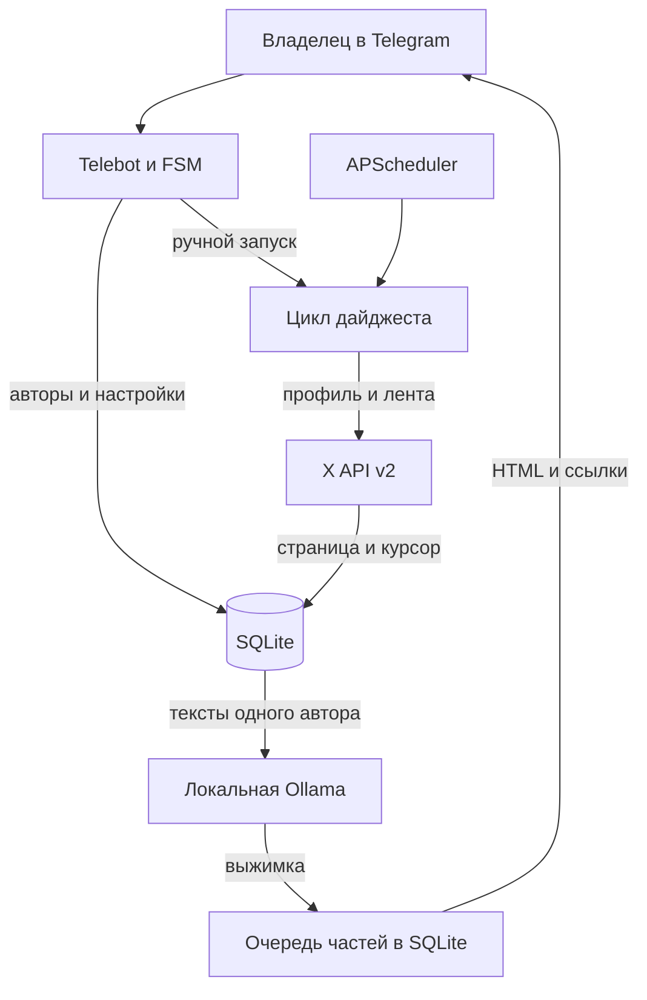
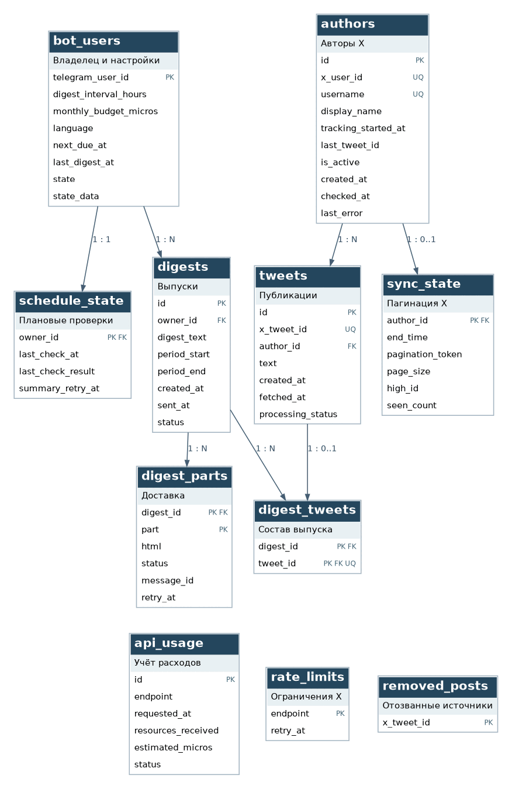

# Проектный практикум — Twitter Digest Bot

Индивидуальный учебный AI/ML-проект для автоматического отслеживания новых публикаций выбранных авторов X (Twitter), хранения твитов в SQLite и формирования кратких персонализированных дайджестов через Telegram-бота.

**Стек** · Python 3.10+, Telebot (pyTelegramBotAPI), официальный X API v2, SQLite, Ollama с Qwen2.5, APScheduler, Docker Compose, Pytest и pytest-cov. Проект рассчитан на одного разработчика и одного владельца бота.

[](https://github.com/Sevey1234/Twitter-parser/actions/workflows/ci.yml)

## Запуск одной командой

Понадобятся Docker Desktop или Docker Engine с Compose, Telegram-бот, публичный X-аккаунт для отслеживания и приложение X с доступом к чтению и кредитами. На первом запуске потребуется интернет для загрузки образов и модели. Для Qwen2.5 7B ориентир — 4–8 ядер CPU и 10–12 ГиБ доступной контейнерам RAM. На рабочей машине с 16 ГиБ общей памяти проще оставить запас системе.

1. Склонируйте репозиторий и перейдите в его корень.
2. Создайте `.env` из `.env.example`. В PowerShell выполните `Copy-Item .env.example .env`, в Linux или macOS — `cp .env.example .env`. Заполните три обязательных поля из следующего раздела.
3. Запустите проект.

```bash
docker compose up --build
```

Если Compose установлен как отдельная программа, используйте команду ниже. Чтение конфигурации проверено также в `docker-compose 1.29.2`.

```bash
docker-compose up --build
```

Сервис `ollama` поднимает локальный сервер модели. `ollama-init` проверяет наличие весов и при первом запуске скачивает их в том `models`. Код завершения 0 у этого одноразового сервиса означает, что модель подготовлена. Затем `bot` создаёт SQLite в томе `database`, запускает Telebot и APScheduler. Откройте личный чат, отправьте `/start`, затем `/add_author`. Журнал приложения доступен через `docker compose logs -f bot`.

Остановить контейнеры и сохранить данные можно командой

```bash
docker compose down
```

**Полная очистка уничтожает SQLite, авторов, твиты, настройки, историю отправки и скачанные веса модели.** Следующие команды создают чистую установку.

```bash
docker compose down --volumes
docker compose up --build
```

## Переменные окружения и секреты

В репозитории хранится шаблон `.env.example`. В локальном `.env` укажите токены и числовой ID владельца. Пустые обязательные поля останавливают запуск с сообщением об ошибке.

```dotenv
TELEGRAM_BOT_TOKEN=
TELEGRAM_ALLOWED_USER_ID=
X_BEARER_TOKEN=
DIGEST_INTERVAL_HOURS=12
MONTHLY_X_API_BUDGET_USD=5
X_POST_READ_USD=0.005
X_USER_READ_USD=0.010
DATABASE_PATH=/data/twitter_digest.db
OLLAMA_MODEL=qwen2.5:7b
```

| Поле | Как получить или изменить |
| --- | --- |
| `TELEGRAM_BOT_TOKEN` | В Telegram откройте официальный `@BotFather`, выполните `/newbot` и перенесите выданный токен в `.env`. [Инструкция Telegram](https://core.telegram.org/bots/tutorial#obtain-your-bot-token) |
| `TELEGRAM_ALLOWED_USER_ID` | Числовой ID вашего личного аккаунта. Принимаются только сообщения этого пользователя в его личном чате с ботом. Способ получить ID приведён ниже. |
| `X_BEARER_TOKEN` | Создайте приложение в X Developer Console, настройте чтение и кредиты. В разделе ключей приложения создайте App-Only Bearer Token. [X Developer Console](https://console.x.com/) |
| `DIGEST_INTERVAL_HOURS`, `MONTHLY_X_API_BUDGET_USD` | Начальные настройки новой базы. После старта используйте `/interval` и `/budget`. Команда `/reset_settings` возвращает значения окружения. |
| `X_POST_READ_USD`, `X_USER_READ_USD` | Цена одного полученного поста и профиля. При изменении ставок обновите значения и пересоздайте контейнер бота. |
| `DATABASE_PATH` | В Compose указывайте путь внутри `/data`, чтобы база оставалась в томе. |
| `OLLAMA_MODEL` | Имя локальной модели Ollama. Compose передаёт боту внутренний адрес `OLLAMA_URL=http://ollama:11434`. При запуске Python на хосте адрес по умолчанию — `http://localhost:11434`. |

Если свой Telegram ID неизвестен, отправьте **свежему** боту `/start` до запуска polling. На компьютере с установленными зависимостями проекта выполните команду из корня. Она берёт токен из `.env` и выводит только имя и ID отправителей личных сообщений. Выберите свою запись.

```bash
python -c "from dotenv import dotenv_values; from telebot import TeleBot; b=TeleBot(dotenv_values('.env')['TELEGRAM_BOT_TOKEN']); print([(u.message.from_user.first_name,u.message.from_user.id) for u in b.get_updates() if u.message and u.message.chat.type=='private'])"
```

## Как работает Twitter Digest Bot

1. Введите `/add_author` и укажите `@OpenAI` или `https://x.com/OpenAI`. Бот проверяет публичный профиль через X API и показывает имя для подтверждения.
2. При нажатии «Подтвердить» в SQLite записываются X User ID и точное время UTC. Это начало отслеживания.
3. Первая проверка передаёт `start_time`. Бот дополнительно сравнивает `created_at` каждой публикации с точной меткой. Твит, опубликованный ровно в момент подтверждения, пропускается.
4. Следующие проверки передают `since_id`. Если страниц несколько, SQLite запоминает границы одного окна, уже полученные строки и следующую страницу.
5. После окончания всех страниц одной транзакцией обновляются `last_tweet_id` и статус твитов. Уникальные идентификаторы защищают от повторов, в том числе при рестарте.
6. Ollama получает все подготовленные тексты одного автора. Для второго автора создаётся отдельный запрос. В дайджест входят русская выжимка, число публикаций и ссылки на каждую из них.
7. Telegram получает общий выпуск. После подтверждения каждой части бот записывает её `message_id`. Когда подтверждены все части, выпуск появляется в истории со статусом «отправлен».

Например, если подтверждение было в 15:00, публикация в 14:59 в дайджест не войдёт. Три новых поста одного автора дадут одну выжимку и три ссылки. При следующей проверке эти три источника повторно в выпуск не попадут. Если новых публикаций нет, автоматическая проверка проходит без сообщения в чат.



[Архитектура, границы транзакций и восстановление](docs/architecture.md)

## Формат дайджеста

Условный пример оформления. Имена и пересказы ниже служат иллюстрацией. В работающем боте каждый номер источника — ссылка на конкретный пост, полученный через X API.

> 📰 **Дайджест X — 21.11.2026**\
> Публикации с 21.11.2026 09:00 по 21.11.2026 21:00 UTC.
>
> **@author_ai**\
> Автор представил обновление модели и показал, какие задачи она решает в редакторе кода. В отдельном сообщении уточнил сроки доступа.\
> 🔗 Источники (5): 1 · 2 · 3 · 4 · 5
>
> **@author_crypto**\
> Автор разобрал изменение комиссии в сети Bitcoin и объяснил его влияние на небольшие переводы.\
> 🔗 Источники (3): 1 · 2 · 3
>
> **@author_dev**\
> Автор выпустил новую версию библиотеки и перечислил исправления. Для обновления проекта он привёл порядок миграции.\
> 🔗 Источники (4): 1 · 2 · 3 · 4
>
> **📊 Итого** · Новых твитов: 12. Авторов: 3.\
> Следующая плановая проверка — 22.11.2026 09:00 UTC. Интервал — 12 ч.

Оригиналы открываются прямо из блока автора. Для примера адреса существующего источника можно открыть [публикацию OpenAI о ChatGPT от 30 ноября 2022 года](https://x.com/OpenAI/status/1598014522098208769). Этот исторический пост не загружается при старте.

Выпуск сохраняет фактические границы периода, включая накопившиеся после простоя публикации. Длинное сообщение делится между авторами. Если один блок очень большой, продолжается список его источников с тем же `@username`. К каждой части добавляется номер выпуска и части. Для реального скриншота предусмотрен [каталог материалов защиты](docs/screenshots/README.md).

## База данных и ER-диаграмма



[Исходная схема DBML](docs/schema.dbml) · [Исполняемый SQL](app/database/schema.sql)

| Таблица | Что хранит и зачем |
| --- | --- |
| `authors` | Уникальные X User ID и username, подпись, начало наблюдения, последний подтверждённый ID, паузу и ошибку последнего чтения. |
| `tweets` | Исходный текст, уникальный ID поста, внешний ключ автора, даты UTC и статус обработки. |
| `digests` | Текст выпуска, владельца, границы периода и время успешной отправки. |
| `digest_tweets` | Состав выпуска. Ограничение `UNIQUE(tweet_id)` позволяет закрепить публикацию только за одним дайджестом. |
| `bot_users` | Единственного владельца, интервал, бюджет, ближайшую проверку и текущее состояние диалога. |
| `api_usage` | Один запрос на строку, вид ресурса, число полученных объектов и оценку расходов в микродолларах. |
| `sync_state` | До одной незавершённой пагинации на автора. Включает верхнюю границу, токен страницы и максимальный полученный ID. |
| `digest_parts` | Готовые HTML-части, состояние каждой отправки, `message_id` и время следующей попытки. |
| `rate_limits`, `removed_posts` | Срок ожидания по методу X и идентификаторы явно отозванных публикаций. |

В базе включены внешние ключи, режим WAL, индексы по статусу, датам и автору. Через 30 суток после отправки бот удаляет выпуск и связанные с ним тексты. Курсор автора хранится дольше истории, поэтому очистка старых дайджестов не возвращает публикации в очередь.

## Интеграция с X API

| Метод | Назначение | Когда выполняется |
| --- | --- | --- |
| `GET /2/users/by/username/:username` | Получить ID, username, имя и признак закрытого профиля | При добавлении. Существующий username находится в SQLite без нового запроса. |
| `GET /2/users/:id/tweets` | Получить публикации публичного автора | По расписанию или по `/digest`, только для активных авторов. |

Для публичных профилей используется App-Only Bearer Token. Ответы и репосты исключаются параметром `exclude=retweets,replies`. Поле `created_at` требуется для повторной проверки времени, полная версия длинного поста запрашивается через `note_tweet`. Руководство X использует имя `tweet.fields`, а справочник метода также описывает `post.fields`. Клиент начинает с первого варианта и переключается при явном HTTP 400 о названии поля. [Руководство по лентам](https://docs.x.com/x-api/posts/timelines/integrate) · [Справочник метода](https://docs.x.com/x-api/users/get-posts) · [Поиск по username](https://docs.x.com/x-api/users/get-user-by-username)

| Параметр или ответ | Как обрабатывается |
| --- | --- |
| `start_time` | При первом чтении — секунда подтверждения. Локальная проверка отбрасывает всё вплоть до точного момента добавления. |
| `since_id` | После успешного чтения — максимальный безопасно обработанный ID. Для редактированных постов сохраняется идентификатор исходной публикации. |
| `end_time` | Фиксирован на весь обход страниц. Верхняя граница отстаёт от текущего времени на 10 секунд. Более свежие записи остаются для следующей проверки. |
| `max_results` | От 5 до 100. На первой странице размер уменьшается под остаток бюджета. Последующие страницы продолжают окно с тем же размером. |
| `meta.next_token` / `pagination_token` | Токен сохраняется вместе со страницей. При отказе X из-за устаревшего токена окно перечитывается от старого курсора. |
| HTTP 429 | Бот сохраняет время из `Retry-After` и `x-rate-limit-reset`. До него соответствующий метод не вызывается. При отсутствии заголовков выдерживается 15 минут. |
| HTTP 401, 402, 403, 404, 5xx или неполная страница | Причина доступна в `/authors` или диалоге добавления. Курсор не перескакивает ошибку. При проблеме одного автора бот может доставить готовые данные остальных. |

## Ограничения и стоимость X API

По опубликованным тарифам на **22 ноября 2026 года** чтение чужого поста стоит **$0,005**, чтение профиля — **$0,010** за возвращённый ресурс. Ставки аккаунта можно сверить в Developer Console. X описывает дедупликацию в рамках календарного дня UTC как мягкую гарантию. Локальная оценка консервативно учитывает каждое получение. [Тарифы и дедупликация X](https://docs.x.com/x-api/getting-started/pricing) · [Лимиты методов](https://docs.x.com/x-api/fundamentals/rate-limits)

Расчёт для **30 суток, трёх новых постов в день на автора**, двух проверок в сутки и одного получения профиля при добавлении. В этом сценарии каждый ответ умещается на одну страницу, все ресурсы различны.

| Авторов | Запросов ленты за месяц | Новых постов | Чтение постов | Профили при добавлении | Первый месяц |
| ---: | ---: | ---: | ---: | ---: | ---: |
| 5 | 300 | 450 | $2,25 | $0,05 | **$2,30** |
| 10 | 600 | 900 | $4,50 | $0,10 | **$4,60** |
| 20 | 1 200 | 1 800 | $9,00 | $0,20 | **$9,20** |

При тех же авторах и активности следующий месяц обойдётся примерно в $2,25, $4,50 или $9,00. Переход с 12 на 24 часа уменьшает число плановых запросов вдвое. Если вернутся те же посты, стоимость их чтения останется прежней.

Перед HTTP-запросом бот резервирует максимальную цену страницы в SQLite. После ответа пересчитывает сумму по реально полученным ресурсам. При сетевой неопределённости остаётся полный резерв. Если остатка меньше минимальной страницы или продолжения уже начатого окна, чтение останавливается. `/budget` меняет предел, `/stats` показывает расход и число ресурсов. Фактические списания видны в консоли X. Локальный бюджет учитывает только запросы этого экземпляра.

Предел пользовательской ленты — 3 200 последних постов, при исключении ответов — 800. После долгого простоя X может уже не вернуть часть интервала. Если бот видит достижение лимита, он показывает ошибку и сохраняет прежний курсор. Для очень активного автора выбирайте короткий интервал. [Ограничения ленты](https://docs.x.com/x-api/posts/timelines/integrate#volume-limits)

## Telegram-бот

| Команда | Действие |
| --- | --- |
| `/start`, `/help` | Открыть список команд |
| `/add_author` | Ввести username или ссылку, проверить в X и подтвердить начало отслеживания |
| `/authors` | Посмотреть список, подписи, паузы и ошибки чтения |
| `/edit_author` | Изменить локальную подпись автора |
| `/pause_author`, `/resume_author` | Остановить чтение или начать новое окно с момента возобновления |
| `/remove_author` | После подтверждения удалить автора и его сохранённые твиты |
| `/interval` | Выбрать 3, 6, 12 или 24 часа. Срок следующего запуска меняется сразу |
| `/digest` | Запросить внеплановую проверку и общий дайджест |
| `/history`, `/history N` | Посмотреть десять последних выпусков или открыть сохранённые части по номеру |
| `/settings`, `/reset_settings` | Посмотреть настройки или вернуть значения окружения |
| `/stats`, `/budget` | Посмотреть статистику и изменить месячный бюджет в USD |
| `/delivery` | Посмотреть статус очереди и разрешить повтор спорной части |
| `/forget_tweet ID` | Отозвать источник. После подтверждения удаляется весь связанный выпуск и его исходники. Бот попытается удалить его сообщения из чата |
| `/cancel` | Отменить текущую операцию. Доступна также кнопка «Отмена» |

FSM добавления проходит шаги «ввод имени → проверка X → подтверждение → запись». Для интервала бот показывает кнопки, проверяет выбор, записывает значение и обновляет задачу APScheduler. Состояние обоих диалогов хранится в SQLite. Запуск другой команды завершает предыдущий диалог. После паузы уже подготовленные до неё публикации сохраняются, а посты, созданные за время паузы, пропускаются.

## AI/ML-функция

**Ollama и Qwen2.5 7B Instruct** работают локально. Это предобученная языковая модель. Она переводит английский текст и создаёт связный русский пересказ нескольких сообщений. Квантованный вариант Q4_K_M занимает около 4,7 ГБ на диске. GPU необязателен. Оставьте место также для Docker-образов. [Карточка модели](https://ollama.com/library/qwen2.5:7b) · [Ollama в Docker](https://docs.ollama.com/docker)

Тексты разделяются по авторам **до** вызова модели. Для большого объёма сначала составляются пересказы порций, затем итоговая выжимка того же автора. Модель возвращает до десяти предложений на автора и дословную опору для каждого. Приложение проверяет соответствие цитат входу, наличие русского текста, длину и числа. После двух неудачных ответов публикации остаются в SQLite до следующей попытки. Ссылки и счётчики формирует Python из записей базы. Пользователь может сверить смысл перевода с оригиналом.

**Проверка модели на CPU.** Отдельный запуск штатного `Summarizer` с настоящими весами `qwen2.5:7b` объединил два английских фрагмента о самой модели в русский текст. В результате сохранились 29 языков и размер 4,7 ГБ. Это проверка генерации на документальных данных. Получение новых постов через аккаунт X проверяется отдельно с ключами владельца.

## Тестирование и CI

```bash
python -m pip install -r requirements-dev.txt
python -m pytest --cov=app --cov-report=term-missing
```

Тот же набор тестов можно запустить командой из задания.

```bash
pytest --cov=app --cov-report=term-missing --cov-fail-under=80
```

Проект поднимает минимальный порог до **81%**, в том числе при явном аргументе `80`. Измеряется весь пакет `app`. Локально на **Python 3.12.14** прошли **62 теста**, покрытие строк **97,72%**.

Тесты используют реальную временную SQLite, настоящий диспетчер Telebot и контролируемые HTTP-ответы. Они проверяют время до, ровно в момент и после подписки, пагинацию после сбоя, отредактированные посты, повторный ID, HTTP 429, конкурирующие резервы бюджета, отдельную генерацию для каждого автора, HTML, FSM и доставку после перезапуска. В приложении присутствует только рабочий путь чтения X API.

GitHub Actions запускает Pytest на двух версиях Python, проверяет Compose, собирает образ, проверяет отказ при пустых секретах и открывает SQLite из второго контейнера. Интеграционная проверка Compose поднимает Ollama, загружает компактную модель `qwen2.5:0.5b` и вызывает генерацию из контейнера приложения. Для этого теста команда бота переопределена в `tests/compose.smoke.yaml`. В штатном режиме контейнер стартует с Telebot и моделью 7B. [Проверка трёх контейнеров в GitHub Actions](https://github.com/Sevey1234/Twitter-parser/actions/runs/44951557179) · [Workflow](.github/workflows/ci.yml) · [Фактические запуски CI](https://github.com/Sevey1234/Twitter-parser/actions/workflows/ci.yml)

## Структура проекта

```text
app/
  main.py, config.py           запуск, сигналы, личный доступ и конфигурация
  bot/                         обработчики Telebot, состояния и клавиатуры
  database/                    SQLite, SQL-схема и репозиторий
  services/                    X API, бюджет, пагинация, планировщик и доставка
  ai/summarizer.py             локальная генерация и проверка результата
tests/                         Pytest и изолированная проверка Compose
docs/
  architecture.md              архитектура и сценарии восстановления
  schema.dbml, er_diagram.png   исходная ER-схема и изображение
  screenshots/                 материалы реального запуска
.github/workflows/ci.yml        автоматические проверки
Dockerfile, compose.yaml       образы, службы и тома
.env.example                   конфигурация без ключей
requirements-dev.txt           зависимости разработки и тестов
```

## Безопасность

Токены находятся в локальном `.env`. Git и Docker исключают его из исходников и контекста сборки. В логах приложения публикуются типы ошибок и безопасные сообщения. Бот принимает команды только из личного чата разрешённого ID. Переменная с токеном Telegram передаётся только контейнеру бота. Порты Ollama и SQLite наружу не публикуются. Запросы с пользовательскими значениями параметризованы, HTML-текст экранируется.

Публикации используются для личной выжимки. Веса модели не обновляются. По требованию X или автора удалите либо исправьте локальную копию как можно скорее, с учётом срока в правилах X. Для отзыва есть `/forget_tweet ID`. Если Telegram уже ограничил удаление старого сообщения или его ID неизвестен, бот перечислит части для ручного удаления. Сохранённые пользователем копии архива в чате также удаляются вручную. [Правила хранения контента X](https://docs.x.com/developer-terms/policy#content-compliance) · [Ограничения Telegram](https://core.telegram.org/bots/api#deletemessage)

## Известные ограничения

- Полный цикл «новая публикация X → сообщение в личном Telegram» требует действующих ключей владельца. Такой запуск и снимок личного чата пока не зафиксированы. Бейдж CI показывает состояние автоматических проверок.
- Telegram Bot API не предоставляет для `sendMessage` клиентский ключ идемпотентности. Если сеть оборвалась после принятия сообщения, часть получит статус `uncertain`. Сверьте видимый номер в чате и выполните точную команду из `/delivery`. Подтверждённые части повторно не отправляются.
- Проверка цитат и чисел снижает риск ошибки модели. Смысловые ошибки перевода возможны, поэтому в каждом блоке доступны все оригиналы.
- Доступна публичная лента в пределах возможностей X API. При достижении предела 800 восстановить более старое содержимое тем же запросом может быть невозможно. Платформа также может удалить или закрыть пост между проверками.
- Пока владелец сверяет спорную часть Telegram, проверки X продолжаются. Новые твиты ждут в базе. Следующий выпуск формируется после завершения предыдущей доставки.
- После явного удаления тома SQLite теряются курсоры и история. Вновь добавленный автор отслеживается с нового подтверждения. Перезапуск с сохранённым томом продолжает прежнее наблюдение.

## Проверка преподавателем

1. **Автоматическая часть без ключей.** Установите зависимости, выполните Pytest. Откройте `tests/test_timeline.py` для проверки времени и восстановления, `tests/test_digest.py` — для проверки доставки и авторских блоков.
2. **Рабочий запуск.** Заполните `.env`, выполните `docker compose up --build`, затем `/start` и `/settings`. Через `/budget` задайте допустимую сумму.
3. **Проверка границы времени.** Добавьте публичный аккаунт, с которого можете опубликовать новый пост. Сначала выполните `/digest` и убедитесь, что старая запись не пришла. После подтверждения автора опубликуйте новый текст, подождите не менее 11 секунд и повторите `/digest` с учётом задержки индексации X.
4. **Проверка авторства и повторов.** При двух авторах с новыми постами убедитесь, что у каждого своя выжимка. Откройте ссылки, сверьте числа и повторно выполните `/digest`. Посмотрите `/history` и `/stats`.
5. **Проверка перезапуска.** Выберите `/interval → 3`, выполните `docker compose restart bot` и проверьте прежнее время запуска в `/settings`. Пример восстановления посреди страницы воспроизводится тестом без дополнительных платных запросов.
6. **Артефакт защиты.** Сохраните снимок реального выпуска без токенов и лишних персональных данных как `docs/screenshots/telegram-digest.png`.

## Возможности развития

Автоматическое применение событий удаления X при доступе к соответствующему API, оценка качества перевода по размеченным примерам и обработка материалов по ссылкам из постов. История функциональных этапов доступна в [Pull Requests проекта](https://github.com/Sevey1234/Twitter-parser/pulls?q=is%3Apr+is%3Amerged).
