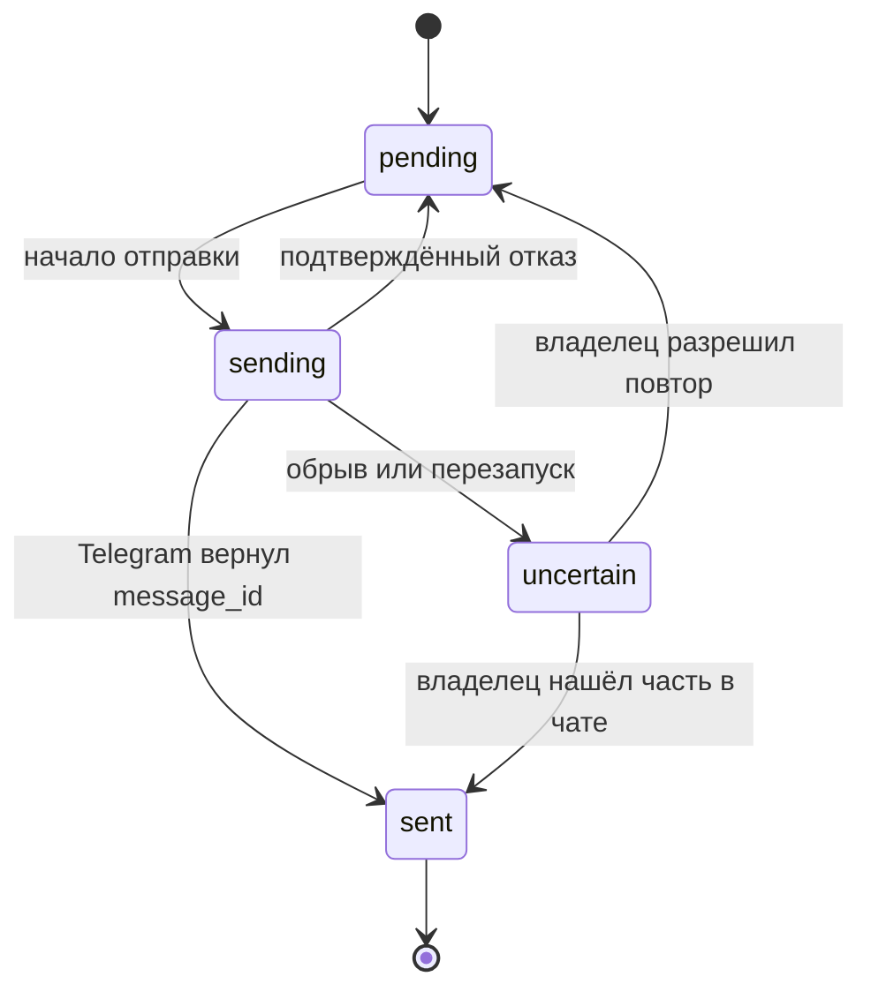

# Архитектура и восстановление

В приложении один владелец, одна SQLite и один процесс Telebot. APScheduler работает в том же процессе. X и Telegram доступны через официальные API. Ollama запущена в отдельном контейнере внутри сети Compose. Блокировка файла базы препятствует запуску второго polling-процесса на том же томе.

| Модуль | Ответственность |
| --- | --- |
| `bot/handlers.py` | Принимает команды владельца, сохраняет шаг диалога и проверяет ввод |
| `services/author_service.py`, `services/twitter_client.py` | Разбирают имя профиля и выполняют два вида запросов X |
| `services/tweet_service.py` | Фиксирует окно, проверяет даты, записывает страницы и завершает обход |
| `services/budget_service.py` | Учитывает запросы, ресурсы, предварительную оценку расходов и ограничения скорости |
| `ai/summarizer.py` | Группирует длинный вход порциями внутри одного автора, вызывает локальную модель и проверяет её ответ |
| `services/digest_service.py`, `services/formatting.py` | Создают по одному блоку на автора, добавляют безопасные ссылки и делят текст на части |
| `services/delivery.py` | Записывает выпуск вместе с источниками, подтверждает части и восстанавливает очередь |
| `services/scheduler.py` | Восстанавливает ближайший автоматический запуск и раз в минуту проверяет очередь доставки |

Пути модулей указаны относительно `app/`.

## Момент начала и курсор X

Время подтверждения хранится в UTC с микросекундами. Первый запрос ограничивается начальной секундой и фиксированным концом окна. SQLite принимает только записи со временем строго позже подтверждения. При редактировании X возвращает новую версию с новым ID. Бот использует историю версий и время исходного Snowflake ID, чтобы поздняя правка старого поста не выглядела новой публикацией.

Каждая страница записывается в одной транзакции с `pagination_token`, `page_size` и максимальным полученным ID. Твиты этой страницы имеют статус `staged`. Другие операции видят записи готовыми только после последней страницы. Тогда одновременно происходят переход `staged → pending`, обновление `authors.last_tweet_id` и удаление `sync_state`. Следующие запросы используют `since_id`. Если после восстановления прежнее окно уже отстало от текущей проверки, бот дочитывает разницу в том же цикле.

| Когда произошёл сбой | Что сохраняется | Действие после восстановления |
| --- | --- | --- |
| X не ответил до записи страницы | Предыдущая страница и курсор | Запрос повторяется с записанной позиции. Неопределённая стоимость остаётся в резерве |
| SQLite записала страницу, процесс остановлен | Источники `staged` и токен следующей страницы | Продолжение с токена |
| X отверг старый токен страницы | Исходный курсор, граница и уже записанные ID | Перечитывается то же окно, дубли устраняет UNIQUE |
| X сообщил HTTP 429 | Время разблокировки метода | До указанного срока запросы этого метода не выполняются |
| Ollama недоступна или вернула неподтверждённую выжимку | Все исходные тексты `pending` | Повтор при следующем цикле или `/digest` |
| Сбой между созданием выпуска и отправкой | Готовые HTML-части и связи с твитами `queued` | Повторно генерировать текст не требуется |
| Telegram распознанно отклонил часть | Отсрочка этой части, ID предыдущих частей | Автоматическая попытка по сроку |
| Связь исчезла в момент отправки | Маркер `sending` или `uncertain` | Владелец сверяет номер в чате через `/delivery` |

## Состояния доставки

Нормальная отправка начинается с записи намерения `sending`. HTTP-запрос происходит за пределами транзакции SQLite. После подтверждения последней части одна транзакция присваивает статусы `sent` всем источникам и выпуску. Для одного владельца частичный уникальный индекс разрешает только один незавершённый выпуск. При незавершённой доставке чтение X продолжается по расписанию. Новые строки остаются в статусе `pending` до освобождения очереди. Опубликованный дайджест можно ещё раз явно открыть через `/history N`, он будет помечен как архив.

## Расписание и доступ

`next_due_at` хранится в базе. `/interval` записывает новую дату и заменяет задание APScheduler. После простоя просроченная задача выполняется один раз, следующая дата рассчитывается по исходной сетке интервала. Ручная команда сохраняет обычное расписание. Общая блокировка цикла и атомарное резервирование публикаций защищают от пересечения ручного и планового запуска.

Имена таблиц и набор операций заданы кодом. Пользовательские строки попадают в SQL через параметры. Загрузка модели и вывод локальны, доступ к Telegram, X и Ollama разделён. Обычный запуск без настроенных ключей завершается с явной ошибкой.

## Что показать на защите

- Для устойчивости к сбою откройте `Timeline.save_page` и тест `test_precise_boundary_resume_pagination_since`. Пока страница не записана, курсор не продвинется.
- Для объяснения AI покажите сначала группировку строк по username в `DigestService.run`, затем системную инструкцию, схему ответа и проверку цитат в `Summarizer`.
- Для связи таблиц откройте ER-диаграмму и уникальный ключ `digest_tweets.tweet_id`. Для спорной доставки покажите `test_crash_between_send_and_ack`.
- Для расчёта расходов сравните ресурсный учёт в `Budget.settle` с количеством строк-запросов в `api_usage`. Изменение интервала влияет на эти показатели по-разному.
